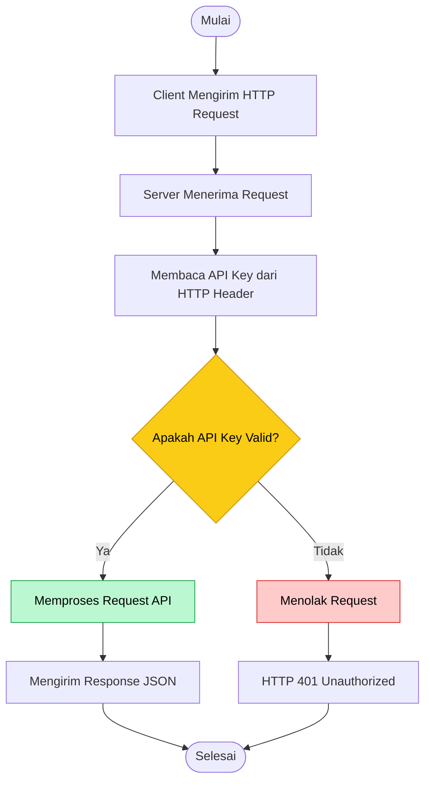

# API Security dengan API Key (PHP Native)

## 1. Pendahuluan

API (Application Programming Interface) merupakan mekanisme yang memungkinkan dua aplikasi atau sistem saling berkomunikasi dan bertukar data.

Namun, endpoint API yang tidak memiliki sistem pengamanan dapat diakses oleh siapa saja yang mengetahui URL endpoint tersebut.

Salah satu teknik pengamanan API yang sederhana adalah menggunakan **API Key Authentication**.

Teknik ini menggunakan sebuah kode unik (API Key) sebagai identitas atau kunci akses yang harus disertakan oleh client ketika mengirimkan HTTP Request ke server.

Server kemudian akan memeriksa apakah API Key yang dikirimkan oleh client sesuai dengan API Key yang telah ditentukan.

Jika API Key valid, server akan memberikan akses ke endpoint API. Sebaliknya, jika API Key salah atau tidak dikirimkan, server akan menolak permintaan tersebut.

---

## 2. Bagaimana API Key Mengamankan API?

API Key berfungsi sebagai kunci akses untuk membatasi siapa saja yang dapat menggunakan endpoint API.

Tanpa API Key, client tidak dapat memperoleh data dari endpoint yang dilindungi.

Contohnya:

- API Key yang benar: `xavier123`
- API Key yang salah: `salah123`

Ketika client mengirimkan request, API Key diletakkan pada bagian HTTP Header dengan nama `X-API-KEY`.

Contoh HTTP Request:

```http
GET /api.php HTTP/1.1
Host: localhost
X-API-KEY: xavier123
```

Server akan membaca nilai `X-API-KEY`, kemudian membandingkannya dengan API Key yang tersimpan di dalam konfigurasi server.

### Skenario Pengamanan

| Kondisi | Respons Server |
|---|---|
| API Key benar | HTTP 200 OK |
| API Key salah | HTTP 401 Unauthorized |
| API Key tidak dikirim | HTTP 401 Unauthorized |

---

## 3. Alur Kerja Sistem

Berikut merupakan alur kerja pengamanan API menggunakan API Key:



### Penjelasan Alur

1. **Client Mengirim Request**

   Client (Postman, cURL, atau aplikasi lainnya) mengirimkan HTTP Request menuju endpoint API.

2. **Server Menerima Request**

   Server menerima permintaan yang dikirimkan oleh client.

3. **Membaca API Key**

   Server mengambil nilai API Key dari HTTP Header dengan nama `X-API-KEY`.

4. **Validasi API Key**

   Server membandingkan API Key yang diterima dengan API Key yang telah ditentukan.

5. **Pemeriksaan Hasil Validasi**

   - Jika API Key benar, server melanjutkan pemrosesan request dan mengirimkan data dalam format JSON.
   - Jika API Key salah atau tidak ditemukan, server menghentikan pemrosesan dan mengembalikan HTTP Status `401 Unauthorized`.

---

## 4. Implementasi Menggunakan PHP

Buat sebuah file bernama `api.php`.

```php
<?php

// 1. Konfigurasi API Key
$API_KEY = "xavier123";

// 2. Mengatur response JSON
header("Content-Type: application/json");

// 3. Mengambil API Key dari HTTP Header
$headers = getallheaders();
$clientKey = $headers["X-API-KEY"] ?? "";

// 4. Validasi API Key
if ($clientKey !== $API_KEY) {

    http_response_code(401);

    echo json_encode([
        "success" => false,
        "message" => "Unauthorized! API Key tidak valid."
    ]);

    exit;
}

// 5. Jika API Key valid
http_response_code(200);

echo json_encode([
    "success" => true,
    "message" => "Akses API berhasil!",
    "data" => [
        "nama" => "Xavier",
        "status" => "Mahasiswa",
        "jurusan" => "Informatika"
    ]
]);

?>
```

### Penjelasan Kode

| Bagian | Fungsi |
|---|---|
| `$API_KEY` | Menentukan API Key yang valid. |
| `getallheaders()` | Mengambil seluruh HTTP Header yang dikirimkan client. |
| `$headers["X-API-KEY"]` | Mengambil nilai API Key dari header. |
| `!==` | Membandingkan API Key yang diterima dengan API Key server. |
| `http_response_code(401)` | Mengirimkan status Unauthorized. |
| `exit` | Menghentikan eksekusi program jika API Key tidak valid. |
| `http_response_code(200)` | Mengirimkan status OK jika API Key valid. |

---

## 5. Pengujian API

API dapat diuji menggunakan dua aplikasi, yaitu cURL dan Postman.

### A. Menggunakan cURL

**1. API Key benar**

```bash
curl -i http://localhost/api.php -H "X-API-KEY: xavier123"
```

Hasil:
- HTTP Status: `200 OK`
- Data API berhasil ditampilkan.

**2. API Key salah**

```bash
curl -i http://localhost/api.php -H "X-API-KEY: salah123"
```

Hasil:
- HTTP Status: `401 Unauthorized`
- Akses ditolak.

**3. Tanpa API Key**

```bash
curl -i http://localhost/api.php
```

Hasil:
- HTTP Status: `401 Unauthorized`
- Akses ditolak.

### B. Menggunakan Postman

1. Buka aplikasi Postman.
2. Buat request baru.
3. Pilih HTTP Method `GET`.
4. Masukkan URL `http://localhost/api.php`.
5. Buka tab **Headers**.
6. Tambahkan header berikut:

| Key | Value |
|---|---|
| X-API-KEY | xavier123 |

7. Klik tombol **Send**.

Jika API Key benar, server akan mengembalikan response `200 OK`.

Untuk menguji kegagalan autentikasi, ubah API Key menjadi `salah123` atau hapus header tersebut.

Server seharusnya mengembalikan response `401 Unauthorized`.

---

## 6. Kelebihan dan Kekurangan

### Kelebihan

- **Mudah diterapkan:** Tidak memerlukan framework atau library tambahan.
- **Implementasi sederhana:** Hanya membutuhkan pengecekan nilai API Key.
- **Membatasi akses:** Client harus memiliki API Key yang valid untuk mengakses endpoint.
- **Ringan:** Tidak membutuhkan database untuk demonstrasi sederhana.

### Kekurangan

- **API Key dapat dicuri:** Jika client tidak menggunakan HTTPS, API Key dapat disadap ketika dikirimkan melalui jaringan.
- **Tidak mengidentifikasi pengguna secara langsung:** API Key lebih cocok sebagai identitas aplikasi atau client, bukan autentikasi pengguna individual.
- **Pengelolaan manual:** Pada implementasi sederhana, perubahan API Key harus dilakukan melalui konfigurasi server.
- **Tidak memiliki pembatasan hak akses:** Semua client yang menggunakan API Key yang sama mendapatkan tingkat akses yang sama.

---

## 7. Rekomendasi Keamanan

Meskipun API Key merupakan teknik pengamanan sederhana, terdapat beberapa hal yang perlu diperhatikan:

1. **Gunakan HTTPS**

   HTTPS mengenkripsi komunikasi antara client dan server sehingga API Key tidak dikirimkan sebagai teks biasa melalui jaringan.

2. **Jangan menyimpan API Key di repository publik**

   Hindari menuliskan API Key asli pada repository GitHub yang dapat diakses oleh siapa saja.

3. **Simpan API Key di Environment Variable**

   Untuk aplikasi yang lebih serius, simpan API Key di environment variable atau konfigurasi server yang tidak dapat diakses publik.

4. **Lakukan Rotasi API Key**

   Ganti API Key secara berkala atau ketika terdapat indikasi bahwa API Key telah diketahui oleh pihak yang tidak berwenang.

5. **Gunakan Autentikasi Tambahan Jika Diperlukan**

   Untuk aplikasi yang membutuhkan pengamanan lebih lanjut, pertimbangkan penggunaan JWT, OAuth 2.0, atau mekanisme autentikasi lainnya.

---

## 8. Kesimpulan

API Key Authentication merupakan salah satu teknik pengamanan API yang sederhana dengan cara melakukan validasi terhadap kode unik yang dikirimkan oleh client melalui HTTP Header.

Dengan teknik ini, server dapat membatasi akses terhadap endpoint API sehingga hanya client yang memiliki API Key valid yang dapat memperoleh data.

Mekanismenya cukup sederhana:

**Client mengirim API Key → Server melakukan validasi → Server memberikan akses atau menolak request.**

Walaupun mudah diterapkan, API Key bukanlah solusi keamanan yang sempurna. Penggunaan HTTPS, pengelolaan API Key yang baik, serta mekanisme keamanan tambahan tetap diperlukan untuk aplikasi yang digunakan dalam lingkungan produksi.
